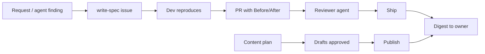

# true-agents-mafia

Skills for running a small crew of AI agents that ship real software. A dev agent proves the bug and the fix with before/after evidence, a separate reviewer checks it and ships when allowed, and the owner gets a short digest of what went out. Simple rules keep the crew quiet unless something matters.



## Install

**Claude Code**
```
/plugin marketplace add gregszero/true-agents-mafia
/plugin install true-agents-mafia@true-agents-mafia
```

**Anything else** (Cursor, other agents): copy the `skills/` folder into your agent's skills directory (e.g. `.claude/skills/` or `.cursor/skills/`).

## Skills

| Skill | What it does |
|---|---|
| `write-spec` | Turn a request, bug, finding, or customer message into one deduped issue with acceptance criteria, priority, and labels. Humans or agents can file. |
| `reproduce-before-after` | Reproduce first, fix, capture the same steps after. No evidence, no PR. |
| `review-and-ship` | Independent reviewer checks evidence, CI, scope, secrets, risk; ships only if policy allows. |
| `shipped-digest` | Scheduled digest of merged PRs, deploys, external sends, and open decisions. Silent if nothing happened. |
| `content-creation` | Plan, draft-as-issue, approve, publish, and report social content. Facts only from the live site. |
| `team-rules` | Quiet by default, report to the lead, one owner per account, draft before sending. |

## License
MIT
