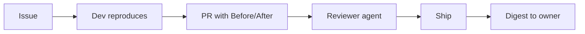

# agent-crew

Skills for running a small crew of AI agents that ship real software. A dev agent proves the bug and the fix with before/after evidence, a separate reviewer checks it and ships when allowed, and the owner gets a short digest of what went out. Simple rules keep the crew quiet unless something matters.



## Install

**Claude Code**
```
/plugin marketplace add gregszero/agent-crew
/plugin install agent-crew@agent-crew
```

**Anything else** (Cursor, other agents): copy the `skills/` folder into your agent's skills directory (e.g. `.claude/skills/` or `.cursor/skills/`).

## Skills

| Skill | What it does |
|---|---|
| `reproduce-before-after` | Reproduce first, fix, capture the same steps after. No evidence, no PR. |
| `review-and-ship` | Independent reviewer checks evidence, CI, scope, secrets, risk; ships only if policy allows. |
| `shipped-digest` | Scheduled digest of merged PRs, deploys, external sends, and open decisions. Silent if nothing happened. |
| `team-rules` | Quiet by default, report to the lead, one owner per account, draft before sending. |

## License
MIT
