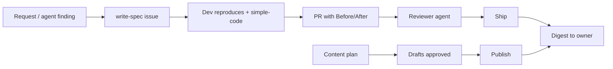

# true-agents-mafia

Skills for a small team of AI agents that ship real software. A dev agent records Before and After evidence for each fix. A different reviewer agent checks the work and ships it when the policy permits. The owner gets a short digest of the shipped items. Agents stay quiet unless an item is important.

All work text (issues, specs, PRs, commits, reports, digests) is in Simplified Technical English (ASD-STE100). The `plain-writing` skill gives the rules. Social and marketing copy (`content-creation`) is exempt.



## Install

**Claude Code**
```
/plugin marketplace add gregszero/true-agents-mafia
/plugin install true-agents-mafia@true-agents-mafia
```

**Other agents** (Cursor and others): Copy the `skills/` folder into the skills directory of your agent (for example `.claude/skills/` or `.cursor/skills/`).

## Skills

| Skill | What it does |
|---|---|
| `write-spec` | Make one issue with no duplicate from a request, bug, finding, or customer message. The issue has acceptance criteria, a priority, and labels. Humans and agents can file. |
| `reproduce-before-after` | Reproduce first. Fix. Record the same steps after. Do not open a PR without evidence. |
| `simple-code` | Make the smallest clear change that solves the issue. Test the real cases in the issue. |
| `review-and-ship` | A different reviewer checks evidence, CI, scope, secrets, risk, and text. The reviewer ships only if the policy permits it. |
| `shipped-digest` | Send a scheduled digest of merged PRs, deploys, external sends, and open decisions. Send nothing if nothing occurred. |
| `plain-writing` | Write all work text in STE: short sentences, active voice, one word for one meaning. |
| `content-creation` | Plan, draft as an issue, approve, publish, and report social content. Use facts from the live site only. Exempt from STE. |
| `team-rules` | Stay quiet by default. Report to the lead. Each account has one owner. Write a draft before you send. Write in STE. |

## License
MIT
